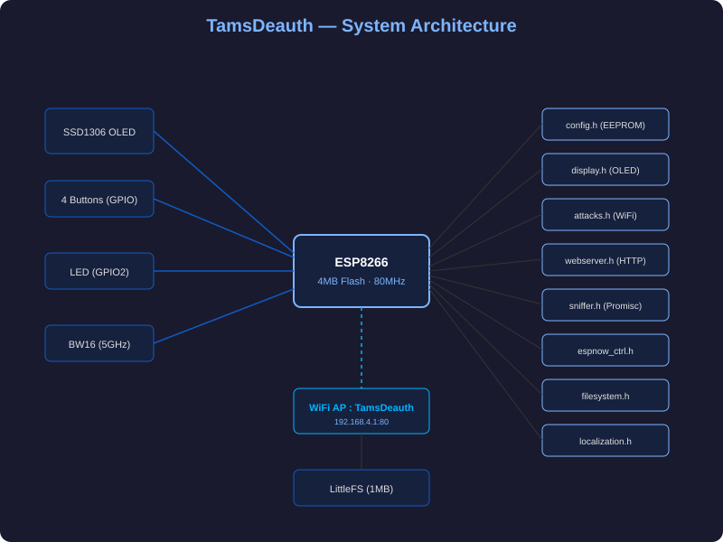
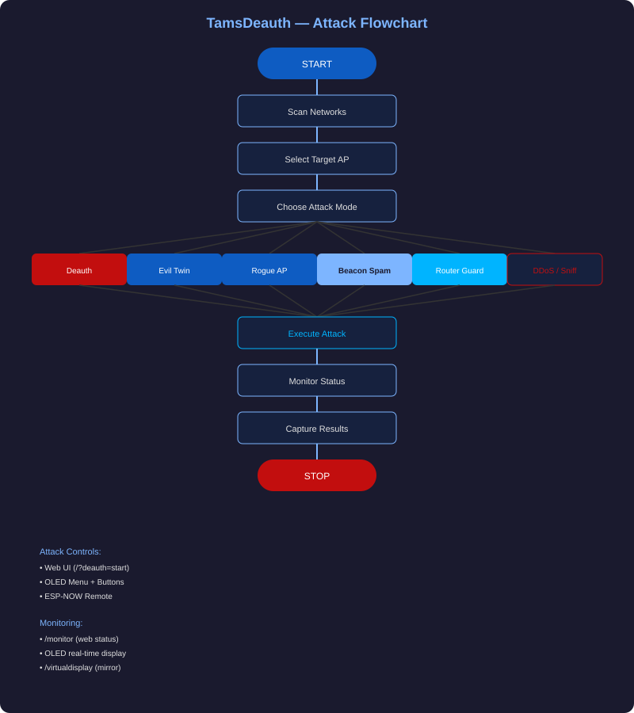
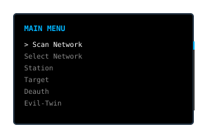
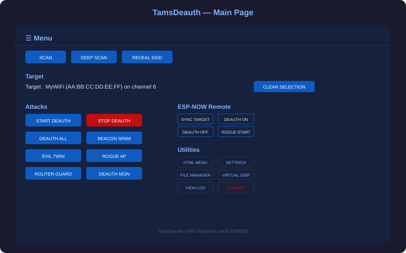
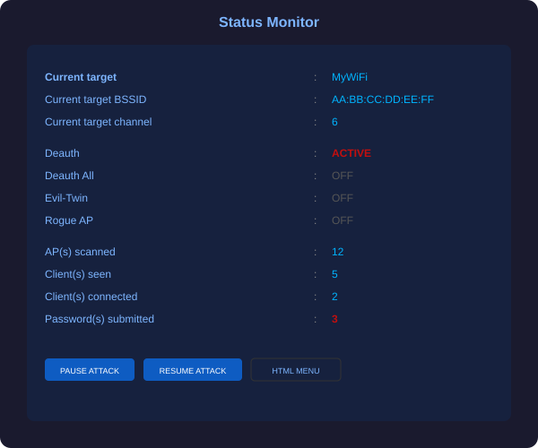
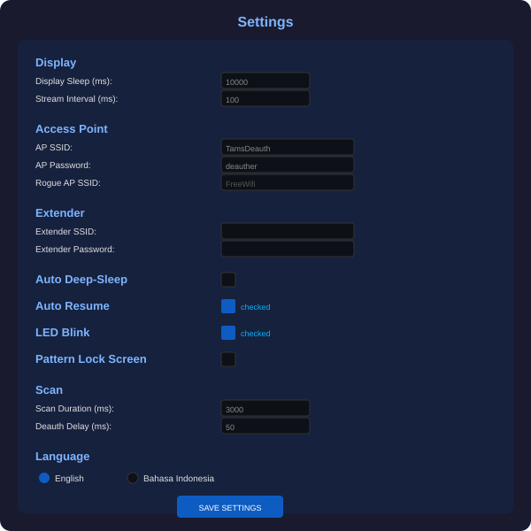
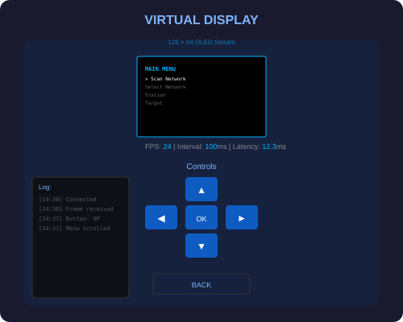

<div align="center">

# 🔥 TamsDeauth

### WiFi Deauther untuk ESP8266

**10+ attack modes · 65 HTTP routes · SSD1306 OLED · ESP-NOW remote · Multi-bahasa**

</div>

---

## 📋 Deskripsi Projek

TamsDeauth itu tool WiFi security testing yang jalan di ESP8266, cocok buat yang mau belajar atau ngetest keamanan jaringan WiFi sendiri. Tool ini punya OLED display buat navigasi menu langsung dari device, plus web interface yang lengkap banget bisa diakses dari browser HP atau laptop.

Intinya device ini bikin WiFi access point sendiri, terus lu connect ke WiFi itu, buka browser ke `192.168.4.1`, dan dari situ lu bisa ngontrol semua fitur — mulai dari scan jaringan, deauth attack, evil twin, rogue AP, beacon spam, sampe router guard. Semua bisa dilakuin dari web UI atau dari OLED + tombol fisik.

Projek ini dibuat dari nol buat ESP8266 dengan 4MB flash, pake SSD1306 OLED 128x64 via I2C, dan 4 tombol fisik buat navigasi menu. Web interface-nya punya 65 route HTTP yang ngapus segala kebutuhan — dari scan, attack control, file manager, text editor, virtual display OLED mirror, sampe OTA firmware update.

## 🏗️ Arsitektur Projek

```
TamsDeauth/
├── TamsDeauth.ino          # Main sketch - setup, loop, button handling, trial mode
├── config.h                 # EEPROM config struct (30 keys), load/save/reset
├── display.h                # SSD1306 OLED menu system (14 items), virtual display
├── attacks.h                # WiFi attacks - deauth, evil-twin, rogue AP, beacon spam
├── sniffer.h                # Promiscuous mode packet capture, station counter
├── espnow_ctrl.h            # ESP-NOW remote control (9 commands)
├── filesystem.h             # LittleFS file browser, upload/download/delete
├── localization.h           # English + Bahasa Indonesia (13 placeholder keys)
├── webserver.h              # HTTP server dengan 65 routes, captive portal, OTA
├── data/                    # LittleFS web assets
│   ├── TamsDeauth.css       # Main stylesheet (dark theme)
│   ├── TamsDeauth_minimal.css
│   ├── admin.css
│   ├── settings.css
│   ├── collapsible.js       # Collapsible menu sections
│   ├── patternLock.js       # Pattern lock setup
│   ├── patternLock_unlock.js
│   ├── IP_override.js       # Captive portal redirect
│   └── time.js              # Time display utility
└── docs/                    # Diagrams dan screenshots
```

### Diagram Arsitektur



### Flowchart Attack Execution



## 🔧 Hardware yang Dibutuhkan

| Komponen | Pin / Interface | Keterangan |
|----------|----------------|------------|
| ESP8266 (NodeMCU/Wemos D1 Mini) | — | Minimal 4MB flash |
| SSD1306 OLED 128×64 | I2C (SDA=GPIO4, SCL=GPIO5) | Address 0x3C |
| Tombol UP | GPIO 14 (D5) | INPUT_PULLUP |
| Tombol DOWN | GPIO 12 (D6) | INPUT_PULLUP |
| Tombol CONFIRM | GPIO 13 (D7) | INPUT_PULLUP |
| Tombol BACK | GPIO 0 (D3) | INPUT_PULLUP |
| LED (opsional) | GPIO 2 (D4) | Active LOW |
| BW16 module (opsional) | Serial | Buat 5GHz deauth |

## ⚡ Fitur Lengkap

### Attack Modes (10)

| # | Attack | Trigger | Deskripsi |
|---|--------|---------|-----------|
| 1 | Deauth | `/?deauth=start` | Kirim 802.11 deauth frame ke client target AP |
| 2 | Precise Deauth | `/?preciseDeauth=start` | Deauth station MAC spesifik dari list |
| 3 | True Deauth | `/?trueDeauth=start` | Real-time channel hopping deauth |
| 4 | Deauth All | `/?deauthAll=start` | Deauth semua AP yang keliatan di scan |
| 5 | Evil Twin | `/?etwin{N}=etwin{N}` | Clone AP SSID + captive portal + password capture |
| 6 | Rogue AP | `/?roguehotspot=start` | Bikin fake AP standalone dengan captive portal |
| 7 | Beacon Spam | `/?beaconSpam=start` | Broadcast fake beacon frame dengan SSID custom |
| 8 | Router Guard | `/?router_guard=start` | MAC whitelist/blacklist enforcement |
| 9 | DDoS Router | Direct call | Flood router dengan TCP/UDP/ICMP packets |
| 10 | Deauth Monitor | `/?deauthmon=start` | Deteksi dan log deauth attack masuk |

### Evil Twin Templates (5+1)

| Template | Route | Fungsi |
|----------|-------|--------|
| Default | `/etwin_default` | Generic WiFi password page |
| Template 1-5 | `/etwin1.html` s/d `/etwin5.html` | 5 varian captive portal design |

### Rogue AP Templates (5+1)

| Template | Route | Fungsi |
|----------|-------|--------|
| Default | `/rogue1.html` (fallback) | Generic login page |
| Template 1-5 | `/rogue1.html` s/d `/rogue5.html` | 5 varian captive portal design |

### Sniffer Modes (4)

| Mode | Command | Deskripsi |
|------|---------|-----------|
| All packets | Internal | Capture semua 802.11 frame |
| Probe requests | `/?sniffer=probe` | Capture probe request frame |
| Deauth monitor | `/?deauthmon=start` | Deteksi deauth/disassoc frame |
| Station observe | `/?sniffer=start` | Hitung station di target AP |

### ESP-NOW Remote Control (9 commands)

| Command | Aksi |
|---------|------|
| `target_sync` | Sinkronisasi target antar device |
| `deauth_on` | Start deauth dari jarak jauh |
| `deauth_off` | Stop deauth dari jarak jauh |
| `deauthall_on` | Start deauth all dari jarak jauh |
| `deauthall_off` | Stop deauth all dari jarak jauh |
| `rogueap_start` | Start Rogue AP dari jarak jauh |
| `softap_hide` | Sembunyikan TamsDeauth AP |
| `softap_show` | Tampilkan TamsDeauth AP |
| `reboot` | Reboot device dari jarak jauh |

## 📺 OLED Menu System

Device pake SSD1306 OLED 128×64 buat display menu. Navigasi pake 4 tombol fisik (UP/DOWN/CONFIRM/BACK) atau via virtual display dari web.

### Menu Hierarchy

```
MAIN MENU
├── Scan Network
├── Select Network
├── Station
│   ├── Count Stations
│   └── Observe Stations
├── Target
├── Deauth
│   ├── Deauth
│   ├── Deauth All
│   ├── Precise Deauth
│   └── True Deauth
├── Evil-Twin
├── Rogue AP
├── Beacon Spam
├── Hide/Show SoftAP
├── DDoS Router
├── Deauth Monitor
├── View Logs
├── TinyJoyPad (minigame)
└── Restart
```

### OLED Display Mockup



## 🌐 Web Interface

Web interface-nya jalan di port 80 dengan 65 route HTTP. Lu akses via browser di `http://192.168.4.1` setelah connect ke WiFi TamsDeauth.

### Halaman Utama

Halaman utama ngeload semua menu, target selection, dan attack control buttons dalam satu page. Ada collapsible section buat Menu dan Target, terus dibawahnya semua tombol attack.



### Status Monitor

Halaman monitor nampilin status real-time dari semua attack yang lagi jalan. Lu bisa liat current target (SSID, BSSID, channel), status deauth/evil-twin/rogue AP, jumlah client yang keliatan, jumlah password yang ke-capture, dll.



### Settings

Halaman settings buat ngatur semua konfigurasi device. Dari sini lu bisa ganti AP SSID/password, atur OLED sleep timer, toggle LED indicator, enable pattern lock, ganti bahasa (English/Bahasa Indonesia), atur deauth delay, scan duration, dll.



### Virtual Display

Virtual display itu kayak mirror OLED lu di browser. Framebuffer 1024 bytes (128×64 pixels) di-stream via HTTP polling, jadi lu bisa liat apa yang ditampilin di OLED langsung dari web. Ada tombol virtual buat navigasi menu juga.



### File Manager

File manager buat browse, upload, download, dan delete file di LittleFS. Lu bisa upload HTML template buat captive portal, edit file text, upload firmware buat OTA update, dll.

### Router Guard

Router guard page buat atur MAC whitelist/blacklist. Lu pilih target AP, count stations yang connect, terus pilih station mana yang boleh/masuk daftar hitam. Device bakal terus monitor dan deauth station yang gak authorized.

## ⚙️ Konfigurasi EEPROM

Semua setting disimpen di EEPROM (4KB), persistent across reboots:

| Key | Tipe | Default | Deskripsi |
|-----|------|---------|-----------|
| AP_SSID | char[33] | TamsDeauth | SSID access point |
| AP_Password | char[65] | deauther | Password AP |
| Rogue_SSID | char[33] | — | SSID Rogue AP |
| Extender_SSID | char[33] | — | SSID extender mode |
| Extender_Password | char[65] | — | Password extender |
| Extended_SSID | char[33] | — | SSID network yang di-extend |
| Extended_Password | char[65] | — | Password network yang di-extend |
| Internet_SSID | char[33] | — | SSID internet connection |
| Internet_Password | char[65] | — | Password internet |
| Attack_Mode | uint8_t | 0 | Mode attack aktif |
| Deauth_Mode | uint8_t | 0 | Tipe deauth (0=none, 1=deauth, 2=all, 3=precise, 4=true) |
| Etwin_Path | uint8_t | 0 | Template evil-twin (0=default, 1-5) |
| Rogue_Path | uint8_t | 0 | Template rogue AP (0=default, 1-5) |
| target_ssid | char[33] | — | SSID target AP |
| target_bssid | uint8_t[6] | — | BSSID target AP |
| target_ch | uint8_t | 0 | Channel target AP |
| deauthDelay | uint16_t | 50 | Delay antar deauth packet (ms) |
| scanduration | uint16_t | 3000 | Durasi scan (ms) |
| OLED_Timeout | uint32_t | 10000 | OLED sleep timeout (ms) |
| OLED_Interval | uint32_t | 100 | Virtual display stream interval (ms) |
| LED_Active | uint8_t | 1 | Toggle LED indicator |
| Resume_Active | uint8_t | 0 | Auto-resume attack setelah power loss |
| Powersave_Active | uint8_t | 0 | Power saving mode |
| Pattern_Lock | uint8_t[16] | — | Pattern lock screen |
| Language | char[8] | en | Bahasa UI (en/id) |
| guard_behavior | uint8_t | 0 | 0=whitelist, 1=blacklist |
| mac_list | uint8_t[16][6] | — | MAC list buat router guard |
| customMAC | uint8_t[6] | — | Custom MAC address |
| peerAddress | uint32_t | 0 | ESP-NOW peer address |

## 🌍 Multi-Bahasa

TamsDeauth support 2 bahasa: English dan Bahasa Indonesia. Pake system placeholder `%KEY%` yang di-replace pas HTML di-serve. Total 13 placeholder:

| Placeholder | English | Bahasa Indonesia |
|-------------|---------|-----------------|
| %PASSWORD% | Password | Password |
| %RECONNECTING% | Reconnecting... | Menghubungkan ulang... |
| %REC_FAILED% | Reconnect failed! | Gagal menghubungkan ulang! |
| %RETRYING% | Retrying | Mencoba lagi |
| %LOWSIGNAL% | Low signal | Sinyal lemah |
| %PLEASEWAIT% | Please wait | Mohon tunggu |
| %INCORRECT% | Password incorrect! | Password salah! |
| %ERRORHEADER% | Error | Error |
| %REENTER% | Re-enter password | Masukkan ulang password |
| %REENTER2% | Please re-enter password | Masukkan password Wi-Fi |
| %SUBMIT% | Submit | Kirim |
| %ADDITIONAL% | Additional | Tambahan |
| %BACKBUTTON% | Back | Kembali |

## 🔨 Build & Flash

### Prerequisites

- Arduino IDE 1.8+ atau PlatformIO
- ESP8266 Arduino Core 3.x
- Library: Adafruit SSD1306, Adafruit GFX, ESP8266WebServer, LittleFS, DNSServer

### Steps

1. Buka `TamsDeauth.ino` di Arduino IDE
2. Pilih board: **NodeMCU 1.0** atau **Wemos D1 Mini**
3. Set flash size: **4MB (FS:1MB, OTA:~1019KB)**
4. Upload LittleFS data: **Tools → ESP8266 LittleFS Data Upload**
5. Upload firmware

### Default AP

```
SSID: TamsDeauth
Password: deauther
IP: 192.168.4.1
```

## 📊 HTTP Route Table (65 routes)

### Core Routes
`/` · `/scan` · `/CurrentTarget` · `/WifiStatus` · `/htmlmenu` · `/howtouse`

### Attack Control
`/start_deauth` · `/stop_deauth` · `/pause_deauth` · `/resume_deauth` · `/beaconspam` · `/getBeaconSSID` · `/sniffer` · `/monitor` · `/routerguard` · `/stop_ap` · `/reboot` · `/fetch_5ghz`

### File System
`/fsbrowser` · `/filecontent` · `/delete` · `/save` · `/texteditor` · `/language_editor`

### Settings & System
`/settings` · `/devmenu` · `/virtualdisplay` · `/localremote` · `/settime` · `/ota_progress` · `/preview`

### Captive Portal Templates
`/etwin_default` · `/captive_default` · `/verify_default` · `/verifypage_default` · `/etwin1-5.html` · `/rogue1-5.html`

### Status & Data
`/packetscount` · `/passwordstatus` · `/log` · `/log.txt` · `/beacons.txt` · `/config.json` · `/guard_config.json`

### Static Files
`/TamsDeauth.css` · `/TamsDeauth_minimal.css` · `/admin.css` · `/settings.css` · `/jquery.min.js` · `/collapsible.js` · `/patternLock.js` · `/patternLock_unlock.js` · `/IP_override.js` · `/time.js` · `/font.woff2` · `/audio.mp3` · `/favicon.ico`

## 📈 Statistik Repo

| Metric | Value |
|--------|-------|
| Source files | 9 (.ino + .h) |
| Data files | 9 (CSS + JS) |
| Total lines code | ~5,500+ |
| HTTP routes | 65 |
| Attack modes | 10 |
| OLED menu items | 14 |
| ESP-NOW commands | 9 |
| Config keys | 30 |
| Localization keys | 13 |
| Languages | 2 (EN + ID) |

## 🧪 Testing

Project udah di-unit test dengan 11 test suite, semua pass:

| Test | Status | Detail |
|------|--------|--------|
| Include Dependencies | ✅ PASS | 21/21 |
| Brace Matching | ✅ PASS | 9/9 |
| HTTP Routes | ✅ PASS | 65/65 |
| Config Keys | ✅ PASS | 30/30 |
| Include Guards | ✅ PASS | 8/8 |
| Attack Functions | ✅ PASS | 19/19 |
| OLED Menu | ✅ PASS | 13/13 |
| ESPNOW Commands | ✅ PASS | 9/9 |
| Localization | ✅ PASS | 13/13 |
| Source Attribution | ✅ PASS | 0 references |
| File Structure | ✅ PASS | 19/19 |

## ⚠️ Disclaimer

Software ini dibuat buat tujuan edukasi dan authorized security testing aja. Misuse software ini buat attack target tanpa izin itu ilegal. Developer gak bertanggung jawab atas penyalahgunaan atau kerusakan yang disebabkan oleh software ini. Gunakan dengan bijak dan hanya di jaringan yang lu punya atau udah dapat izin buat ngetest.

## 📝 License

Projek ini open-source buat tujuan edukasi dan research.

---

<div align="center">

**TamsDeauth** — WiFi Deauther untuk ESP8266

Dibuat dengan ❤️ buat komunitas WiFi security testing

</div>
